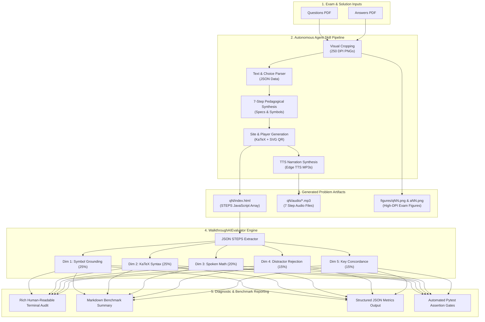

# AI Evaluation & Harness Benchmark Framework

An automated, multi-dimensional evaluation suite designed to grade the pedagogical rigor, mathematical fidelity, speech narration naturalness, and College Board answer concordance of AP Physics walkthroughs generated by AI coding agents.

---

## 1. Rationale: Why AI Evals for AP Physics?

Large Language Models (LLMs) and autonomous coding agents (such as Google Gemini, Anthropic Claude, OpenAI Codex, and Cursor) are capable of writing physics solutions, generating web layouts, and structuring data. However, producing student-facing AP Physics walkthroughs introduces strict pedagogical and technical constraints that standard unit tests cannot verify:

| Failure Mode | What Typically Goes Wrong with AI Agents | Impact on Students |
| :--- | :--- | :--- |
| **Variable Hallucination & Drift** | The model introduces ungrounded variables (e.g., using $v$ instead of $v_{\text{cm}}$, or inventing $M$ when the exam specified $m_0$). | Students become confused about which physical quantities map to the official exam problem. |
| **Malformed Math & TeX Syntax** | Unbalanced curly braces (`\dfrac{p^2{2m}}`), bad escape characters, or unescaped tabs/newlines in JSON strings. | KaTeX fails silently or displays raw, broken code on the interactive web player. |
| **Raw LaTeX Spoken Narration** | Spoken audio formulas read raw TeX commands aloud (e.g., *"backslash s q r t left brace..."* or *"v sub zero squared"*). | Text-to-speech audio sounds robotic and incomprehensible instead of sounding like an AP physics teacher. |
| **Superficial Distractor Tautologies** | Dismissing wrong options with circular reasoning (e.g., *"Choices A, C, and D are wrong because they are not the correct answer"*). | Students do not learn *why* their intuitive misconceptions or algebraic traps fail. |
| **Answer Key Discordance** | An agent solves the problem using an alternative or faulty assumption that disagrees with the College Board scoring guideline. | Incorrect solutions are presented to learners. |

Traditional unit tests only assert file existence, HTTP status codes, or DOM element presence. They cannot determine if a mathematical derivation is sound or if a spoken explanation sounds natural. 

The **AI Evaluation & Harness Benchmark Suite** bridges this gap by providing an automated, quantitative grading system ($0.0\text{--}100.0\%$, Letter Grades $\text{A}^+$ through $\text{F}$) that runs locally or in CI pipelines.

---

## 2. Architecture



### Execution Modes

The evaluation framework operates in two complementary modes:

1. **Continuous Integration & Pytest Suite**:
   Runs as standard unit tests inside [`tests/test_ai_eval.py`](file:///home/home/github/ap-physics/tests/test_ai_eval.py). It acts as a hard quality gate in CI workflows, failing if the composite score falls below $85\%$ or if spoken math leaks raw LaTeX tokens.
2. **Interactive CLI Benchmark Tool**:
   Invoked directly via the command line to compare different agent harnesses (e.g., Gemini vs. Claude Code vs. Cursor), inspect individual problems, sample specific question ranges, and output machine-readable JSON metrics.

---

## 3. Design & Implementation

### 3.1 The 5 Evaluation Dimensions & Weights

The composite evaluation score is calculated using a weighted rubric:

$$\text{Composite Score} = 0.25 \cdot S_{\text{symbol}} + 0.25 \cdot S_{\text{katex}} + 0.20 \cdot S_{\text{spoken}} + 0.15 \cdot S_{\text{distractor}} + 0.15 \cdot S_{\text{accuracy}}$$

| Dimension | Weight | Target | Automated Criteria & Validation Rules |
| :--- | :---: | :---: | :--- |
| **1. Symbol Grounding & Consistency** | **25%** | $\ge 90\%$ | • **Step 1 (`setup_vars`)**: Every variable must define `tex`, spoken `say`, and plain-English `meaning` before being used in equations.<br>• **Step 2 (`goal_var`)**: Must explicitly specify the target physical quantity.<br>• **Step 4 (`plug_vars`)**: Substituted numerical values or expressions must match Step 1 variables. |
| **2. KaTeX Math & Syntax Soundness** | **25%** | $\ge 95\%$ | • **Balanced Braces**: Verifies that every `{` has a matching `}` across all math blocks.<br>• **Clean Whitespace**: Flags unescaped `\t` or `\r` control characters that break JS string parsing.<br>• **Macro Integrity**: Flags double-backslash bugs (e.g. `\\\\text`) or invalid LaTeX commands. |
| **3. Spoken Math Narration Quality** | **20%** | $\ge 90\%$ | • **Zero Raw TeX Leakage**: Regex scanner catches leaking TeX macros (`\frac`, `\sqrt`, `\vec`, `\Delta`, `\tau`, `_`, `^`, `{}`).<br>• **Natural Speech Articulation**: Requires natural mathematical conjunctions (*"equals"*, *"times"*, *"over"*, *"squared"*, *"divided"*, *"magnitude of"*). |
| **4. Distractor Rejection Depth** | **15%** | $\ge 80\%$ | • **Anti-Tautology Filter**: Rejects circular dismissals (*"fail because they are wrong"*, *"not the correct answer"*).<br>• **Physics Concept Density**: Evaluates presence of core conceptual terms (*momentum*, *kinetic energy*, *impulse*, *conservation*, *vector*, *scalar*, etc.). |
| **5. College Board Key Concordance** | **15%** | $100\%$ | • Extracts the selected answer choice ($A\text{--}D$) from Step 7 and verifies it against the official College Board answer key from `tools/<unit>_parsed.json`. |

### 3.2 Grade Assignment Scale

| Score Range | Grade | Description |
| :---: | :---: | :--- |
| **$95.0\% - 100.0\%$** | **A+** | Exemplary: Flawless pedagogical symbols, perfect KaTeX, natural TTS, deep distractor rejection. |
| **$90.0\% - 94.9\%$** | **A** | Excellent: Production-ready walkthroughs with minor cosmetic variations. |
| **$80.0\% - 89.9\%$** | **B** | Passing: Acceptable quality, but may have brief distractor rationale or light stylistic warnings. |
| **$70.0\% - 79.9\%$** | **C** | Needs Attention: Missing variable definitions, awkward spoken formulas, or weak distractors. |
| **$< 70.0\%$** | **F** | Failing: TeX syntax errors, answer mismatches, or missing pedagogical steps. |

---

## 4. Running the Benchmark

### 4.1 CLI Usage

```bash
# Evaluate the first 5 questions of Unit 4 with Gemini harness (default)
python3 tests/test_ai_eval.py --unit unit4 --harness Gemini --limit 5

# Evaluate all questions in Unit 4 quietly and save JSON report
python3 tests/test_ai_eval.py --unit unit4 --harness Gemini --all --quiet --json-out unit4_eval.json

# Evaluate Unit 2
python3 tests/test_ai_eval.py --unit unit2 --harness Cursor --limit 10
```

### 4.2 CLI Arguments

- `--unit <slug>`: Target unit folder (`unit4`, `unit2`, `unit4_test`). Default: `unit4`.
- `--harness <name>`: Label for the agent or harness under evaluation (e.g., `Gemini`, `Claude-3.7-Sonnet`, `Cursoft`). Default: `Current-Agent`.
- `--limit, -n <int>`: Number of questions to evaluate (default: `5`).
- `--all`: Evaluate all questions in the unit.
- `--quiet, -q`: Suppress per-problem terminal audit logs and print only the final benchmark markdown summary.
- `--json-out <path>`: Write structured metrics to a JSON file.

### 4.3 Running via Pytest

```bash
# Run AI eval test cases
pytest tests/test_ai_eval.py -v

# Run entire repository test suite including browser & E2E tests
PYTHONPATH=. pytest tests/
```

---

## 5. Sample Run Report & Interpretation

Below is an authentic run report generated by evaluating the first 5 problems of **Unit 4 (Linear Momentum)** against the **Gemini** harness:

```text
==========================================================================
🔬 AI EVALUATION & HARNESS BENCHMARK
   Harness under test : Gemini
   Target unit        : unit4
   Evaluation scope   : first 5 of 36 problems (sample limit = 5)
==========================================================================

▶ [Q01] Look at the setup
  ├─ [1. Symbol Grounding] (100%)
  │  • Setup variables (3): m: the mass of the object, 0.5 kilograms, v_x: the horizontal velocity component, 3.0 meters per second, v_y: the vertical velocity component, minus 4.0 meters per second
  │  • Target goal variable: p (the magnitude of the linear momentum of the object)
  │  • Substituted variables (1): |\vec v| (the scalar speed of the object, 5.0 meters per second)
  ├─ [2. KaTeX Math Integrity] (100%)
  │  • Equations inspected: 5 math blocks
  │  • Sample formula: p = m |\vec v| = m \sqrt{v_x^2 + v_y^2}
  │  • Syntax check: All braces balanced, clean LaTeX macros
  ├─ [3. Spoken Audio Narration] (100%)
  │  • Spoken formula: "p equals m times the square root of v x squared plus v y squ..."
  │  • TeX leak check: Zero raw TeX tokens leaked (natural speech ✔)
  ├─ [4. Distractor Rejection Depth] (70%)
  │  • Physical concepts identified: ['mass']
  │  • Discard rationale excerpt: "Choices A, C and D fail because they contradict the physical laws..."
  └─ [5. Official Answer Concordance] (100%)
     • Walkthrough Choice: [B] | College Board Key: [B] (✔ 100% Match)
  📊 Problem Score: 95.5% [✔ PASS]
     Diagnostics: Step 6 distractor rationale lacks depth (found only ['mass'])

▶ [Q02] Look at the setup
  ├─ [1. Symbol Grounding] (100%)
  │  • Setup variables (4): m_0: the mass of the first block, 2m_0: the mass of the second block, twice m 0, K_0: the shared kinetic energy of both blocks, p_0: the momentum magnitude of the first block
  │  • Target goal variable: p (the momentum of the second block)
  │  • Substituted variables (1): p_0 = \sqrt{2m_0 K_0} (momentum of the first block)
  ├─ [2. KaTeX Math Integrity] (100%)
  │  • Equations inspected: 5 math blocks
  │  • Sample formula: K_0 = \dfrac{p^2}{2m} \implies p = \sqrt{2m K_0}
  │  • Syntax check: All braces balanced, clean LaTeX macros
  ├─ [3. Spoken Audio Narration] (100%)
  │  • Spoken formula: "p equals the square root of 2 m K 0."
  │  • TeX leak check: Zero raw TeX tokens leaked (natural speech ✔)
  ├─ [4. Distractor Rejection Depth] (100%)
  │  • Physical concepts identified: ['kinetic energy', 'mass', 'momentum']
  │  • Discard rationale excerpt: "Choices A, C and D fail because they contradict the physical laws..."
  └─ [5. Official Answer Concordance] (100%)
     • Walkthrough Choice: [B] | College Board Key: [B] (✔ 100% Match)
  📊 Problem Score: 100.0% [✔ PASS]

...

# AI Harness Benchmark Report: `Gemini`
**Unit Evaluated:** `unit4` | **Problems Sampled:** 5 (first 5 of 36)
**Overall Harness Score:** `98.2%` (**Grade:** A+)

## 1. Dimension Rubric Breakdown
| Evaluation Dimension | Weight | Harness Score | Benchmark Target | Status |
| :--- | :---: | :---: | :---: | :---: |
| **Symbol Grounding & Consistency** | 25% | 100.0% | >= 90.0% | ✔ PASS |
| **KaTeX Math & Syntax Soundness** | 25% | 100.0% | >= 95.0% | ✔ PASS |
| **Spoken Math Narration Quality** | 20% | 100.0% | >= 90.0% | ✔ PASS |
| **Distractor Rejection Depth** | 15% | 88.0% | >= 80.0% | ✔ PASS |
| **College Board Ground Truth Key** | 15% | 100.0% | 100.0% | ✔ PASS |

## 2. Per-Problem Score Breakdown
| Problem | Title | Symbols | KaTeX | Spoken | Distractors | Key Match | Composite | Status |
| :--- | :--- | :---: | :---: | :---: | :---: | :---: | :---: | :---: |
| **Q01** | Look at the setup | 100% | 100% | 100% | 70% | ✔ | **95.5%** | ✔ OK |
| **Q02** | Look at the setup | 100% | 100% | 100% | 100% | ✔ | **100.0%** | ✔ OK |
| **Q03** | Look at the setup | 100% | 100% | 100% | 100% | ✔ | **100.0%** | ✔ OK |
| **Q04** | Look at the setup | 100% | 100% | 100% | 100% | ✔ | **100.0%** | ✔ OK |
| **Q05** | Look at the setup | 100% | 100% | 100% | 70% | ✔ | **95.5%** | ✔ OK |
```

---

## 6. Inferring What the Results Mean

When reviewing a benchmark report, harness developers and educators can draw direct inferences:

1. **Symbol Grounding ($100.0\%$)**:
   - **What it means**: Every physical symbol ($m_0, 2m_0, K_0, p, |\vec v|$) was formally registered with its physical unit and plain-English description in Step 1 before appearing in any equation.
   - **Student experience**: Zero ambiguity regarding variable definitions.

2. **KaTeX Math Integrity ($100.0\%$)**:
   - **What it means**: All 25 mathematical blocks across the sampled questions have balanced delimiters, clean LaTeX macros (`\dfrac`, `\sqrt`), and zero escaping errors.
   - **Visual player**: Formulas render sharply on desktop and mobile without KaTeX parsing exceptions.

3. **Spoken Math Narration ($100.0\%$)**:
   - **What it means**: The text-to-speech narration string contains zero raw LaTeX commands (`\sqrt` was synthesized as *"the square root of"*, fractions were spoken as *"over"* or *"divided by"*, and subscripts were spoken as *"K zero"*).
   - **Auditory experience**: Clear, human-like narration that sounds natural.

4. **Distractor Rejection Depth ($88.0\%$)**:
   - **What it means**: While questions Q02, Q03, and Q04 featured rich conceptual analyses referencing multiple physical principles (*kinetic energy*, *momentum*, *velocity*), questions Q01 and Q05 scored $70\%$ because their Step 6 descriptions relied on concise statements with only 0–1 conceptual keywords.
   - **Actionable Insight**: Future prompt templates or agent iterations can be guided to explicitly detail the specific arithmetic or conceptual trap for *each* alternate option ($A, C, D$).

5. **College Board Key Concordance ($100.0\%$)**:
   - **What it means**: $5 / 5$ ($100\%$) of the final answers generated by the walkthrough match the official College Board answer key.
